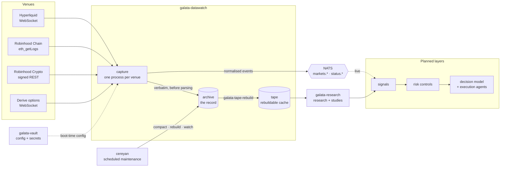

<picture>
  <source media="(prefers-color-scheme: dark)" srcset="assets/logo-on-dark.svg">
  
</picture>

# galata-datawatch

[](https://github.com/sercanatalik/galata-datawatch/actions/workflows/check.yml)
[](LICENSE-MIT)
[](rust-toolchain.toml)
[](https://crates.io/crates/galata-datawatch)

**Multi-venue market data capture and Parquet archival, in Rust.**

galata-datawatch captures market data from several venues. Every payload is
stored verbatim before anything parses it, gaps are recorded as explicit
events, and a queryable Parquet tape can be rebuilt from that archive at any
time. It is the data layer of **Galata**, a low-latency algorithmic trading
framework.

> **Status: 0.1.0, published 2026-09-29.** Capture, the archive, the tape,
> the broker, vault integration and scheduled maintenance are all built, and
> the reference deployment runs them as launchd services. The four crates are
> on crates.io. See the [Roadmap](#roadmap).

---

## Contents

- [Galata at a glance](#galata-at-a-glance)
- [Design principles](#design-principles)
- [Architecture](#architecture)
- [The crates](#the-crates)
- [Venues](#venues)
- [Quick start](#quick-start)
- [Storage layout](#storage-layout)
- [Querying the tape](#querying-the-tape)
- [The account ledger](#the-account-ledger)
- [Operations](#operations)
  - [Configuration and secrets](#configuration-and-secrets)
  - [Scheduled maintenance](#scheduled-maintenance)
  - [Running as services](#running-as-services)
- [Development](#development)
- [Publishing](#publishing)
- [Roadmap](#roadmap)
- [Related repositories](#related-repositories)
- [Licence](#licence)

---

## Galata at a glance

Galata is a Rust framework for low-latency algorithmic trading. It covers the
whole path from market data to orders:

1. **Multi-venue market data capture.** This repository.
2. **Research.** The record loaded with its semantics applied once, and
   studies judged against selection (the Deflated Sharpe Ratio, the
   Probability of Backtest Overfitting). A strategy is tested only against the
   data it could have seen at the time.
3. **Signal generation.** Features and signals are computed from the tape and
   can be reproduced from the archive.
4. **Deterministic portfolio risk controls.** Plain, auditable code that sits
   between every decision and every order. No model can override it.
5. **Agentic strategy execution.** A fine-tuned decision model turns market
   signals into calibrated probabilities. Execution agents act on those
   probabilities, inside the limits the risk layer sets.

Every layer after the first reads from the record this repository keeps, so
the record has to be complete and replayable, and it has to state its gaps.
Backtests and live runs therefore work from the same bytes.

### Infrastructure



| Component | Role | Repository |
|---|---|---|
| **galata-datawatch** | capture, the archive, the tape, the broker vocabulary | this one |
| **galata-vault** | end-to-end-encrypted configuration and secrets; the single source of both | [sercanatalik/galata-vault](https://github.com/sercanatalik/galata-vault) |
| **cereyan** | the scheduler that runs compaction, tape rebuilds and health checks | [sercanatalik/cereyan](https://github.com/sercanatalik/cereyan) |
| **NATS** | the live bus that downstream strategy processes subscribe to | [nats.io](https://nats.io) |
| **galata-research** | the record as polars or DuckDB with its semantics applied once, and marimo studies judged by DSR and PBO | [sercanatalik/galata-research](https://github.com/sercanatalik/galata-research) |

---

## Design principles

| Principle | What it means in practice |
|---|---|
| **Archive first** | Every payload lands verbatim before a parser sees it. A parse bug costs a re-run, never the data. |
| **Gaps are events** | Every absence is written down with its cause and bounds. Nothing is inferred from missing rows. |
| **The frontier is a listing** | "How far am I durable?" is answered from directory entries, with no Parquet decode. |
| **Venues are features** | A venue that is not compiled in cannot be reached, and a guard checks that. |
| **The tape is a cache** | Delete it and `galata-tape-rebuild` writes it again, byte for byte, from the archive. |
| **No float money** | Prices and sizes are decimals end to end. A guard fails any `f64` on a money path. |
| **The loop owns the clock** | Adapters are pure and clockless, so every normalisation can be replayed in a test. |

---

## Architecture

Each venue runs as its own capture process, and every payload follows one
path through it:

```text
  transport ─bytes─▶ Archive ──▶ Adapter::normalise ──▶ Envelope ──▶ Sink (NATS)
  (stream │ poll    (fsync,       (pure: no clock,       (galata-wire)
   │ block range)    rename)       no I/O)
                        │
                        └──────────▶ galata-tape-rebuild ──▶ tape (Parquet, by dataset)
```

- **The transport** sits above the venue seam and owns any credentials: a
  long-lived WebSocket stream, a signed REST poll, or paging a chain by block
  range.
- **`Adapter`** is the venue seam, and it is pure. It turns bytes into
  events, classifies failures, and declares the venue's subscriptions,
  symbols and limits. It never sees a socket or a clock, and it defines no
  method that places, cancels or amends an order.
- **Archive, normalise, emit** is implemented once, in `ingest`, so the order
  holds by construction rather than by convention.
- **Positions** are generalised in `galata-segments` as
  `Cursor::{Time, Block, Seq}`, which makes a blockchain venue a first-class
  source rather than a special case.

**A silence is not a gap; a dead connection's is.** A connection can die
without closing — a change in the host's network did exactly that to a
container's on 2026-11-25 — and a quiet market and a dead connection deliver
the same nothing. What tells them apart is the venue's keepalive:

- **A quiet market on a live connection is never a gap**, however long.
- **A venue that declares how soon it answers its keepalive**
  (`ConnectionPolicy::reply_secs`; Hyperliquid answers its 20-second ping
  within 10 seconds) is dead once one goes unanswered for that long, with no
  frame of any kind since. Capture records a `session_lost` gap for every pair,
  each from its own last receipt, and connects again at once. A death is found
  within the keepalive interval plus the reply time.
- **A handover claims continuity only across a live connection.** The one being
  replaced is asked to show it is alive after its replacement is subscribed;
  if it shows nothing within the reply time, its silence is a `session_lost` gap
  up to the replacement's subscription, not coverage.
- **A venue that declares no reply time** has nothing inferred from its silence.

Normalised events are published on NATS as `markets.<venue>.<ticker>.<kind>`,
and each capture reports its own health on `status.<venue>`. The two roots are
granted separately, so a dashboard can read status without the market-data
firehose.

**The broker keeps a window of the bus.** JetStream holds two hours of market
data, so a consumer replays from where the hourly tape ends and then follows
live; each venue's latest status; and, for the ledger's change, a complete
seven-day stream of account data under `accounts.<venue>.<alias>.<kind>`. The
streams are declared beside the grants and applied by the broker's own start
(`galata-bus`); see [`galata-broker`](crates/galata-broker).

**The market window is lossy, and every hole in it is declared.** Capture
drops an event from the bus, never from the record, when its queue to the
broker is full or a publish is refused. It keeps the earliest and latest
receipt time dropped, and sends, for every pair it covers, a gap with the
cause `unpublished` over that span:

- **`unpublished` means the record holds what the bus did not carry.** A
  consumer that meets one fetches the span from history. Every other gap cause
  says the data exists nowhere.
- **Where the hole is.** Sent just before the first event received after the
  span, or, if none comes, once a publish succeeds with the queue empty: what
  the queue still held from before the span is published first, so a
  consumer reading in order meets the declaration between the last event
  before the hole and the first after it.
- **Sent on the bus and never archived**, so the tape never holds one.
- **Every pair, over the whole span.** A consumer of one instrument meets the
  hole on that instrument's own subject; where only some pairs dropped, the
  declaration overstates the loss, which is the safe direction.
- **Never dropped to make room for data.** A declaration that cannot be sent
  stays pending and is merged with the next span.

---

## The crates

| Crate | Holds | Links |
|---|---|---|
| [`galata-wire`](crates/galata-wire) | the vocabulary: `Envelope`, `Event`, `Kind`, `Series`, `Ticker`, `Num` | `serde` only |
| [`galata-broker`](crates/galata-broker) | `Publisher`/`Subscriber`, subjects, identities and grants, the NATS implementation | `galata-wire` |
| [`galata-segments`](crates/galata-segments) | durable Parquet segments: write, sync, rename, compact | `arrow`, `parquet` |
| [`galata-datawatch`](crates/galata-datawatch) | the record, the venue seam, the capture loop, the tape, the operator binaries | all three |

A downstream process that only needs to *hear* market data takes the first
two, and links no columnar format:

```toml
galata-wire   = "0.1"
galata-broker = "0.1"
```

`crates/galata-datawatch-vault` is an unpublished fifth member. It keeps the
vault integration in the workspace so that a guard can prove the four
published crates link none of it.

### Binaries

| Binary | Purpose |
|---|---|
| `galata-datawatch` | capture one venue, with configuration from a file |
| `galata-datawatch-vault` | the same, with configuration and secrets fetched from galata-vault at boot |
| `galata-ledger` | record one venue's declared accounts: margin, positions, balances, borrowing and history ([The account ledger](#the-account-ledger)) |
| `galata-session-key` | make a Derive session key, its private half to a pipe only (`scripts/make-derive-session-key.sh` hands it to the vault); behind `derive-xyz` |
| `galata-tape-rebuild` | project the archive into the tape; `--replace` rebuilds a venue's range |
| `galata-compact` | merge the small segments of closed days, and with `--closed-hours` of today's closed hours (never the open hour) |
| `galata-watch` | judge the record's freshness and completeness, per venue |
| `galata-retain` | report, and optionally delete, what a retention horizon would expire |
| `galata-signals-commit` | check one run of computed signals against the dataset's schema and write it to the tape |
| `galata-bus` | the broker's process: applies the stream table once the server answers, and is `nats-server` meanwhile |
| `galata-margin` | advise where to place an option on Derive and its perpetual hedge, and what each placement costs against the owner's book ([Margin advice](#margin-advice)); acts on nothing |

---

## Venues

```sh
cargo add galata-datawatch --features rh-chain
```

| Feature | Venue | Source | Credential | Instruments (v0.1) |
|---|---|---|---|---|
| `hyperliquid` | Hyperliquid perps, including the HIP-3 `xyz` dex | WebSocket stream | none | BTC, ETH, HYPE, `xyz:WTIOIL`, `xyz:XYZ100`, `xyz:GOLD` |
| `rh-chain` | Robinhood Chain (Arbitrum Orbit L2, chain 4663) | block cursor over `eth_getLogs`, bounded at finalized | provider RPC key | tokenized equities |
| `rh-crypto` | Robinhood Crypto Trading API | signed REST poll (Ed25519) | API key + private key | top of book |
| `derive-xyz` | Derive (derive.xyz) options | WebSocket stream, with reference data by REST | none | up to 50 named options, and each underlying's index and perpetual |

**Derive's instruments expire.** An option is named in full
(`BTC-20261225-60000-P`), the set is capped at 50, and each option leaves the
set at the hour the venue states: the status file lists it under `left`, the
others keep capturing, and nothing rolls the slot to another option. One
ticker payload a second becomes three rows: the top of book in `quotes`, the
mark, index and open interest in `marks`, and the venue's own implied
volatility and greeks in `option_pricing`. Public trades are not captured.

Beside the options, and declared by nobody, the venue's capture follows each
underlying in the set: its index (`BTC-USD`, in `marks`) and its perpetual
(`BTC-PERP`: its top of book in `quotes`, its mark in `marks` and its funding
rate in `funding`). Neither counts toward the 50. A perpetual the venue does
not list is left out and said so on the status file; the options start
without it. Book depth is not captured.

Hyperliquid captures `bbo`, trades, candles and `activeAssetCtx`. Its `bbo`
and rh-crypto's `best_bid_ask` share one `quotes` dataset, so a cross-venue
quote comparison is a single-table query.

**Every venue's reference data is in one format** (`instruments`): galata's
ticker beside the venue's own symbol and dex, the contract, base and quote,
and the venue's price, size and margin rules, each stated as the venue states
it and absent where it states nothing. `Instrument::price_is_valid` tells
whether a price is one the venue takes, from the row alone. A row carries the
moment it was read, so the tape answers what an instrument's terms were then.

- **Hyperliquid** reads each captured dex's `meta` at capture's start and
  every five minutes, one request per dex, and records a row per captured
  coin. Its prices have no fixed tick: `tick_size` is the finest grid its
  decimal places allow, `10^-(6 - szDecimals)`, and `price_figures` (5) caps
  a price's significant figures, a whole number excepted. Its minimum order is
  a value, `min_notional` (10 in the dex's collateral), with `min_size` the lot
  size. `max_leverage` and `isolated_only` are the venue's own. The two rules
  the venue documents and serves nowhere, the five figures and the minimum
  value, are named constants in the adapter. The quote is the dex's collateral
  token, named through the venue's canonical tokens (`USDC`); one not known
  here is left empty. A coin the venue has delisted is recorded inactive and
  leaves the set.
- **Derive** reads each instrument's reference data every five minutes, with
  a fixed `tick_size`, a size minimum, and its venue symbol; it states no
  significant-figure cap, value minimum or leverage, so those are absent.
- A reference read that fails is said once, capture goes on, and it is asked
  again at the next interval; its return is said once too.

**A venue can live in your own crate.** `Adapter`'s documentation carries a
worked example that compiles.
[`tests/out_of_tree_venue.rs`](crates/galata-datawatch/tests/out_of_tree_venue.rs)
checks that claim: cargo builds the file as a separate crate, so it sees only
what an outside user sees. If a venue needs something private, the compiler
names it. docs.rs builds with `all-features = true`, so every venue is
documented and each gated item shows the feature it needs. A streaming venue
of your own states whether it answers its keepalive, and how soon
(`ConnectionPolicy`'s `reply_secs`); `None` keeps its silence uninterpreted.

---

## Quick start

Requirements: Rust 1.98 (pinned by `rust-toolchain.toml`). NATS is optional
for local capture, and [uv](https://docs.astral.sh/uv/) is needed for the
scheduled flows.

```sh
git clone https://github.com/sercanatalik/galata-datawatch
cd galata-datawatch

cargo test                                   # no network access
cargo run --release --bin galata-datawatch   # capture Hyperliquid into var/archive
cargo run --release --bin galata-tape-rebuild -- --help
```

The capture binary reads [`config/datawatch.toml`](config/datawatch.toml),
the committed and annotated configuration, unless `GALATA_CONFIG` names
another file. A configuration that is absent, unparseable or out of bounds is
rejected at load, and the process exits non-zero before it does anything.

---

## Storage layout

```text
  var/archive/                    THE RECORD: one row per payload, verbatim,
   venue=hyperliquid/               before any parse was attempted
     kind=quotes/
       date=2026-09-20/
         t-1758326400000000_1758326460000000_4711_3.parquet
         failures/                  same sequence, no payload column

  var/tape/                       THE CACHE: one row per event, typed, by
   kind=quotes/                     venue time, rebuildable from the record
     date=2026-09-20/
       s-1790058447399177_1790058637809031.parquet
```

The archive is partitioned by venue, because its unit is the capture: a
venue's bytes are kept, replayed or dropped as one subtree. The tape's unit is
the dataset, so one dataset across every venue is a single prefix. In the
tape, `venue` is a column and deliberately not a directory level. Written
both ways, DuckDB's `hive_partitioning` flag decides which value a reader
sees, with no warning.

Segment filenames carry the range they cover and the fact that they are
durable. A segment is only named after its bytes have been synced, so readers
never see a half-written file. See
[`galata-segments`](crates/galata-segments/README.md).

---

## Querying the tape

The tape is plain, Hive-partitioned Parquet. DuckDB, polars and pyarrow read
it with no flags:

```sql
SELECT * FROM read_parquet('var/tape/kind=quotes/**/*.parquet');
```

| Dataset | Contents |
|---|---|
| `quotes` | top of book: bid/ask price and size |
| `trades` | executions, with the venue's `trade_id` |
| `candles` | OHLCV bars, live and walked back through venue history |
| `funding` | funding rates |
| `marks` | mark, index and oracle prices, and open interest |
| `gaps` | every known absence, with cause and bounds |

Two things to know before filtering:

- **`at_micros` is null when the venue did not timestamp the event.** That is
  common. Over a 24-minute run, 100% of `marks` and 89% of `funding` had no
  venue time, against 0% of `quotes` and `trades`. Filling in the receipt time
  would turn missing information into a latency of zero, so the column stays
  null, and `WHERE at_micros BETWEEN …` silently drops all of `marks`. Filter
  on `recv_micros`, or use the bounded reader.
- **An execution can arrive twice.** A venue that replays recent history on
  subscribe does so again on every reconnection: 1.55% of a 24-minute run,
  once per session rotation. Both receipts are recorded because both
  happened. Group on `trade_id` to count each execution once.
- **`candles` holds several intervals at once**: galata's live 1m bars, most
  of whose rows are updates to the forming bar, and the venue's 1h, 4h and 1d
  bars walked back through its history. Filter on `interval` before grouping
  on `at_micros`, or a venue hourly bar received later takes the minute it
  shares.

### Candles at a period

`tape::bars` builds candles at 1m, 3m, 5m, 15m, 30m, 1h, 2h, 4h, 8h, 12h or
1d from the `candles` dataset, exactly, in the tape's own decimal units. It is
what galata-markets serves (`add-galata-markets`), and the one place a bar is
built, for a history read and a live stream alike.

- **The source is chosen, never mixed.** A bar is built from the finest held
  interval that divides its period and covers it with final bars; failing
  that, the finest with any bars in it. A venue hourly bar beside 59 of 60
  final minutes is the complete answer; for the hour still forming, galata's
  live minutes are. A 5m bar is never made from an hourly one.
- **Each source bar at its latest version**: the row received last for its
  interval and moment.
- **A bar says what it is**: its source interval, how many source bars it
  holds against how many its period does, whether a recorded gap touches it,
  and whether every source bar in it was final. One missing its first or last
  minute is incomplete by construction.
- **Aligned to UTC, and whole**: a bar begins at a multiple of its period
  from the epoch (a day at 00:00 UTC), and a window selects whole bars, so a
  bar is the same in every answer.
- **A span no source covers is named, not filled**: 5m bars from before 1m
  capture began come back as an unsourced span, never as hourly bars.

---

## The account ledger

`galata-ledger <venue>` records the operator's own accounts, as `capture`
records markets: every answer archived verbatim before anything reads it, a
missed read recorded as a gap, and **nothing computed** from what the venue
states. It reads Hyperliquid by address, with no key, and Derive with a
session key ([below](#derive-a-wallet-read-with-a-session-key)).

```text
  every snapshot_secs   per account and dex     clearinghouseState   ──▶ margin, positions
                        per account             spotClearinghouseState ──▶ balances,
                                                                         portfolio_margin, token_margin
                        per account             borrowLendUserState  ──▶ borrow_lend, lend_health
                        per account, every dex  frontendOpenOrders   ──▶ orders, ONE set per read
  every discover_secs   per master              subAccounts, userRole, userAbstraction
                        for the venue           spotMeta: names the tokens the two above refer to
  every events_secs     per account             fills, funding payments, ledger updates
                        per account             historicalOrders     ──▶ order_updates
                        per account             portfolio            ──▶ pnl_history, every window

  var/ledger/          THE RECORD, owner-only (0700): venue=/account=<alias>/kind=/date=
  var/ledger-tape/     ITS PROJECTION, owner-only: venue=/account=<alias>/kind=/rows.parquet
```

- **Under portfolio margin and unified account, the collateral is spot**: the
  margin row's account value is not the equity, and its `equity_not_held`
  says the collateral is recorded as balances. Under portfolio margin the
  venue also states its own portfolio-margin ratio and per-token ratios, which
  are recorded as stated (`portfolio_margin`, `token_margin`).
- **An account's state is read, not dated by the venue**: balances, borrowing
  and the portfolio figures carry their read's receipt as their time. A reader
  takes an account's newest rows of a kind with `ledger::project::newest`, so
  it never mixes one read's balance with another's.
- **Orders are state and events** (`add-account-vocabulary-orders`):
  - `orders` is the open orders of the newest read, every declared dex in one
    set, recorded only when every dex answered. A read that found none is a
    file of zero rows. Open orders never read are no file at all, so *nothing
    rests* and *nothing known* stay apart.
  - `order_updates` is each change of an order's status, once. Its identity is
    the order id, the status and the venue's time for the change.
  - `pnl_history` is each point of each window the venue states (`day`,
    `week`, `month`, `allTime` and their `perp` forms), once, by window and
    time.
  - Order type, trigger and status are the venue's own words, never mapped.
- **A market is named as the venue names it**: an order's and a fill's market
  is text, so a spot pair (`@107`, `PURR/USDC`) is kept. The fold counts spot
  fills apart (`spot_fills`), since a spot trade moves no perp position.
- **Its cost is declared**: each read's weight counts against `ledger_share`
  of the venue's budget, and a configuration that cannot afford its cadences
  is refused at load. Open orders cost 20 a dex each snapshot, and the order
  and PnL history 40 an account each events pass.
- **An address never names anything**: accounts are aliases (`main`, and
  `main_s1` for a discovered sub-account) in every path, subject and log.

**Real time** (`add-realtime-account-ledger`). Each ledger also holds its
venue's account stream, one connection for every account, and publishes what
it records to the bus's `ACCOUNTS` stream:

```text
  Hyperliquid   by address: state per dex, spot state, open orders, order
                updates, fills, funding, ledger updates (a ping each 30 s)
  Derive        public/login with the session key, then each bound
                subaccount's {id}.balances, .orders, .trades
  each frame    recorded first, verbatim, under ws/<channel>
  the bus       accounts.<venue>.<alias>.<kind>, as ledger-<venue>,
                read past a cursor (var/ledger/venue=<v>/publication.json)
```

- **Each event is published once**, by its identity, however often the
  venue repeats it or however it arrives, stream or REST.
- **Each state kind is published as one set**: every dex's newest rows
  together, at most one a second, and not again while it is unchanged.
  Hyperliquid pushes its state every 5 s, changed or not. An empty set is a
  message with no rows.
- **Nothing is counted until the stream acknowledges it.** A broker outage or
  a restart resumes from the cursor, in order. With no cursor yet, the stream
  begins at the record's end; history is the projection's.
- **REST is the backstop.** Every connection and reconnection reads each
  account's state and its events at once, and the cadenced reads go on.
  - A Hyperliquid order update or fill, which does not carry the whole
    order, asks for the order history at once.
  - A Derive frame asks for the wallet's snapshot at once.
- **The ledger compacts its own record** hourly: nothing else can read its
  root.
- **Its stream is on the status surface**, per account: `stream_connected`,
  `stream_connected_micros`, `stream_frame_micros`, `stream_down_micros`. The
  health judge warns `stream-down` once it has been down a minute.
- **Its identity is `ledger-<venue>`**, password
  `GALATA_BROKER_PASSWORD_LEDGER_<VENUE>`. It may publish only
  `accounts.<venue>.>` and hear only its own inbox. A `[broker]` that refuses
  it stops the ledger; one that does not answer is published to once it does.

### Derive: a wallet, read with a session key

Built with `--features derive-xyz`. An account with `venue = "derive-xyz"`
names the Derive wallet and the session key that signs its reads, and no
dexes:

```toml
[ledger.account.owner]
venue = "derive-xyz"
# The Derive wallet the key is registered to. NOT the address the owner signs
# in with: a request naming that one is refused by Derive's gateway with a bare
# 403. `public/get_wallets_from_session_key` names it from the key's address.
address_var = "GALATA_LEDGER_DERIVE_WALLET"
session_key_var = "GALATA_LEDGER_DERIVE_SESSION_KEY"
# Days before the key expires from which the status warns. 14 when absent.
session_key_warn_days = 14
```

```text
  boot, and every discover_secs   public/get_wallets_from_session_key  the key is the wallet's, or nothing is signed
                                  private/session_keys                 its scopes and expiry
                                  private/get_subaccounts              subaccounts, bound to owner_s1, owner_s2, …
  every snapshot_secs             private/get_all_portfolios           ──▶ margin_state, position_state, collateral,
                                  ONE request per wallet                   orders, per subaccount
  every events_secs               private/get_order_history            ──▶ order_updates
                                  private/get_trade_history            ──▶ fills
                                  private/get_funding_history          ──▶ funding_payments
                                  private/get_subaccount_value_history ──▶ pnl_history, window "3600"
                                  each wallet-wide, a whole window
```

- **The key.** Make one with `scripts/make-derive-session-key.sh`, which hands
  its private half straight to the vault and prints the public address; or
  make it in Derive's interface and enter the private half at `gv set`'s
  hidden prompt. Register the address on the wallet with the owner's
  subaccounts, an expiry, and no scope beyond trading.
- **What the key may hold**: protocol scopes under `trade`, and the off-chain
  `account_info` and `block_trade`. One key serves the ledger and the owner's
  trading (`add-derive-account-ledger`, design D4); the ledger itself places,
  amends and cancels no order. It refuses to start, or stops at the next
  discovery, naming the reason, when the key holds anything else
  (`withdraw`, `transfer:…`, `liquidate`, `set_session_key`, `vault:…`,
  `admin`, or a scope Derive adds later), is registered to another wallet,
  is not listed, has expired, or could not be checked.
- **Its expiry is on the status surface** (`key_expires_micros`), with a
  `key_warning` once fewer than `session_key_warn_days` remain. Renew the key
  before then.
- **The margins are net**: a subaccount's `margin_state` initial and
  maintenance margin are what is left over the requirement, positive being
  headroom; a position's and a collateral's are each one's contribution
  (measured 2026-11-27, `design/measured.md`).
- **A subaccount's identifier never names anything**: it stays inside the
  archived answers, and the subaccount is `owner_s1` in every path and status.
  The wallet's answer is recorded under the wallet, and projected under each
  subaccount.
- **Its history is read a whole window at a time**: every page of the window,
  recorded under the wallet only when every page answered. A window with a
  missing page is a gap for each subaccount.
  - Trades, funding and value points are read from the newest the record
    holds, so a missed window is read again by the next.
  - Orders reach back 30 days every time, since Derive states an order once,
    at its latest status, and it changes after it appears. A change superseded
    between two reads is not seen.
  - The value history is asked hourly, and its points are each subaccount's
    value and margins as stated. Derive states no PnL, and none is computed.
- **Its cost**: Derive allows 300 reads a minute per wallet, shared with the
  owner's own use. A rate refusal's stated wait holds the venue, and a
  snapshot due inside it is a throttled gap. The four history windows cost a
  read each, a page each as measured.

---

## Margin advice

`galata-margin advise` compares where to place a Derive option's perpetual
hedge: all beside the option on Derive, all on Hyperliquid, or split. Each
placement is costed against the owner's real book, and the cheapest inside
the owner's cap is proposed (`add-cross-venue-margin-optimiser`).
**It advises and does nothing else**: it names no request that places,
amends or cancels an order or moves funds, which `tests/acts_on_nothing.rs`
holds.

```sh
gv run --env galata-datawatch/mainnet \
  --only GALATA_LEDGER_DERIVE_WALLET,GALATA_LEDGER_DERIVE_SESSION_KEY,GALATA_LEDGER_FINGERPRINT_KEY -- \
  target/release/galata-margin advise --option BTC-20261225-60000-P --size -1 --price 2100 \
    --hedge-size -0.47 --derive owner_s3 --hyperliquid main          # --json for the same figures, exactly
```

| Term | Where it comes from |
|---|---|
| Derive's margin | Derive's own simulation of the subaccount with the option and the hedge's part added (`private/get_margin`), the fall in net initial margin |
| Hyperliquid's margin | computed: `size × mark / leverage`; under portfolio margin, maintenance from the venue's published ratio, checked against the ratio it states and labelled an estimate while they disagree |
| Buffer | the notional held on Hyperliquid times Derive's largest spot shock for the underlying (BTC 14%) |
| Execution | each venue's book, read when advice is asked for, walked at the part's size |
| Funding | each venue's current hourly rate, read when advice is asked for, over the declared holding period |

**Every figure says where it came from** (`v` the venue, `c` computed, `c*`
an estimate) and how old its account snapshot is. A snapshot older than the
declared bound gives no figure, and says so. A placement missing any term is
shown incomplete and never proposed.

**The key is the ledger's.** One Derive session key serves the ledger and
the owner's trading, so it holds `trade:all`. At start the optimiser asks
the venue for the key's scopes and applies the ledger's own rule: trading
scopes, `account_info` and `block_trade` are accepted, and anything that can
move funds is refused by name. Make the key as the ledger section above
says. A key with no scopes at all is read-only, and serves too.

**Its settings are the owner's**: a `[margin]` block, every key required and
bounded, an unknown key refused. galata-datawatch holds it as written, so
every tool reading the document must be built from a tree that knows the
block before one is written (`config/datawatch.toml` shows it, commented):

```toml
[margin]
session_key_var = "GALATA_LEDGER_DERIVE_SESSION_KEY"
agreement_tolerance = "0.001"   # of the portfolio margin ratio; 310 snapshots agreed within it
snapshot_age_secs = 900         # no shorter than the ledger's snapshot_secs
split_pct = [25, 50, 75]        # the hedge's share on Derive, 1 to 5 of them
funding_hours = 168             # the holding period funding is counted over
venue_cap_pct = 100             # the largest share of the hedge one venue may hold

[margin.accounts]
derive-xyz = ["owner_s3"]       # subaccounts, by the ledger's aliases
hyperliquid = ["main"]
```

---

## galata-markets: market data over HTTP

`galata-markets` (`crates/galata-markets`, `add-galata-markets`) is the one
door for market data: history from the tape, candles at a period, what
exists, and the live window. A client needs its token and nothing else; it
never connects to the bus. The service reads the tape and the archive
read-only, reads the bus as `markets` and publishes nothing, and links no
venue transport (`scripts/check-markets-no-transport.sh`).

**Every request but `/health` and `/v1/health` carries a client's token**, as
`Authorization: Bearer <token>`. The clients are a table in the code
(`controlboard`, `watcher`, `operator`), each token held in the vault as
`GALATA_MARKETS_TOKEN_<CLIENT>`. No token and a token not issued are refused
alike, and the refusal names no client.

| Route | Answers | As |
|---|---|---|
| `/v1/tape/{kind}?venue&ticker&from&to` | one dataset's rows over a venue-time window | Arrow IPC |
| `/v1/candles?venue&ticker&period&from&to[&format=json]` | candles at a period (`tape::bars`) | Arrow IPC, or JSON with `format=json` |
| `/v1/prices?venue&tickers[&since]` | each ticker's newest mid and mark from the market window, and its range since a moment | JSON |
| `/v1/venues` | each venue, its dexes, and its capture's latest health | JSON |
| `/v1/instruments?venue&base&contract_type&active&at` | each instrument's reference data, in the one format | JSON |
| `/v1/instruments/{venue}/{ticker}` | the same, and what the tape holds for it | JSON |
| `/v1/health` | every service's state and findings, judged when asked; no token | JSON |
| `/health` | that it answers; no token | text |

```sh
T="Authorization: Bearer $GALATA_MARKETS_TOKEN_OPERATOR"
M=http://<the Mac's tailnet name>:<port>

# A day of BTC's funding, as Arrow IPC.
curl -sH "$T" "$M/v1/tape/funding?venue=hyperliquid&ticker=BTC&from=1795564800000000&to=1795651200000000" -o btc-funding.arrows

# BTC's 5m candles over an hour.
curl -sH "$T" "$M/v1/candles?venue=hyperliquid&ticker=BTC&period=5m&from=1795687200000000&to=1795690800000000" -o btc-5m.arrows

# Every venue and its capture's health.
curl -sH "$T" "$M/v1/venues"

# Every BTC instrument, across venues.
curl -sH "$T" "$M/v1/instruments?base=BTC"

# One instrument, and what is held for it.
curl -sH "$T" "$M/v1/instruments/hyperliquid/BTC"
# Every service's health, with no token.
curl -s "$M/v1/health"
```

- **History is the tape's own columns**, prices `Decimal128(38, 18)`, oldest
  first. Each answer's Arrow schema metadata says where the tape ends,
  `galata.bound.<venue>`: the live stream continues after that position with
  nothing missing and nothing repeated.
- **Limits are refused, never cut short**, naming the limit: quotes one ticker
  at a time and a day per request, other datasets 31 days, an answer at most
  2,000,000 rows, candles at most 200,000 bars.
- **Candles** add `galata.unsourced` to the metadata, a JSON list of `[from,
  to)` spans no source covers. Each bar carries `source_interval`,
  `sources`, `sources_expected`, `complete`, `gap` and `is_final`.
- **Candles as JSON** (`format=json`) are the same bars, decimals as exact
  strings, with `bound` (where the tape ends, `null` where it holds none of
  the venue) and `unsourced` beside them. Arrow stays the default.
- **Prices now** (`/v1/prices`) come from the market window, seconds old.
  - Each ticker gets its newest `mid` (a quote's, halfway between bid and
    ask, or the venue's own on a mark) and its newest `mark`, each with
    `at_micros`.
  - Its `price` is the mid, or the mark where there is none.
  - With `since`, it also gets the `high` and `low` price since that moment,
    from every quote and mark, each with its time. A `since` older than the
    window is refused (`410`), naming the oldest moment it holds.
  - A ticker the window holds nothing of is listed under `absent`.

  ```sh
  curl -sH "$T" "$M/v1/prices?venue=hyperliquid&tickers=BTC,ETH"
  ```
- **A venue's health is its capture's own report**, with the moment it was
  made; one older than a minute says `current: false`.
- **The deployment's health** (`/v1/health`, `add-service-health-monitoring`)
  is judged when asked, from each service's own latest report:
  - capture's on the bus;
  - from the status folder: each ledger's status and fold report, the
    launcher's record of each start, and `galata-watch`'s `watch.json`.

  Each service is `well`, `warning` or `down`. A finding has an identity,
  `<service>/<kind>[/<subject>]`, that stays the same while the fact holds,
  for instance:
  - `ledger:derive-xyz/held`;
  - `capture:hyperliquid/not-reporting`;
  - `flows/refused`.

  It needs no token: galata-markets is on the tailnet only, and a finding
  names service names, aliases, counts, times and reasons, never an address,
  an identifier or an amount. galata-watcher asks it every minute, and tells
  Telegram once when a finding appears and once when it clears.

  ```json
  { "at_micros": 1795790000000000, "state": "warning",
    "services": [ { "service": "ledger:derive-xyz", "state": "warning",
                    "reported_at_micros": 1795789990000000,
                    "findings": [ { "id": "ledger:derive-xyz/held", "kind": "held",
                                    "observed": "ledger:derive-xyz is held for a rate refusal until 2026-11-27 14:33:23 UTC",
                                    "expected": "no hold" } ] } ] }
  ```
- **An instrument's reference data** is its newest row, or as of `at`;
  `reference` is null where none is held yet. What is held is per dataset and,
  for candles, per source interval, computed on first asking and kept fifteen
  minutes.

### The live stream

`/v1/live?venue&tickers&kinds[&period][&after|&from]` is server-sent events:
each market event as the bus carried it, its decimals strings, for up to 50
tickers of one venue and the datasets named (every one where `kinds` is
absent).

```sh
# BTC's and ETH's quotes, live.
curl -NsH "$T" "$M/v1/live?venue=hyperliquid&tickers=BTC,ETH&kinds=quotes"

# Continue a history read: everything after its galata.bound.hyperliquid.
curl -NsH "$T" "$M/v1/live?venue=hyperliquid&tickers=BTC&kinds=quotes&after=1795640818220259"

# BTC's forming 5m bar, each time one of its minutes changes.
curl -NsH "$T" "$M/v1/live?venue=hyperliquid&tickers=BTC&kinds=candles&period=5m"
```

- **Each event's id is its position in the market window.** A client that
  reconnects with `Last-Event-ID` (as a browser's `EventSource` does by
  itself) resumes after it: nothing missed, nothing repeated. A position the
  window no longer holds is refused (`410`), naming the oldest it does: read
  the rest from history.
- **Where it starts**: after a history answer's tape bound (`after`), so the
  two hold every envelope once — refused where the window begins after the
  tape ends; from a moment in the window (`from`); or from now.
- **A hole the bus declared is filled in place.** Where capture declared that
  the bus missed a span, the stream sends, at the declaration's place, the
  record's events for that span that the window does not hold, as
  `event: fill`, with the same sequence and receipt time capture gave them;
  the last carries the declaration's id. A client resuming from before it
  receives the same fill. Where the record cannot be read in time, or the
  span is too large, the declaration itself is sent (`event: declaration`),
  naming the span to read from history.
- **Bars**: with `period`, the stream carries candles as bars (`event: bar`),
  built as `/v1/candles` builds them — the current period seeded from the
  tape, the window's updates folded in, a bar each time one changes.
- **A client that falls behind** is disconnected, with a final comment
  saying so, rather than slowing the others or dropping events silently; it
  resumes with `Last-Event-ID`, the window being its buffer.

### Account data

galata-markets serves the owner's accounts as it serves market data
(`add-markets-accounts`): what each account holds now, its history and its
live stream. They come from the ledger's projection (`[ledger] tape`,
mounted read-only) and the bus's account stream, and galata-markets changes
neither. An account is named by its venue and alias, never an address: the
projection is written by alias, and the account stream's subjects and rows
are too. The ledger's record, which holds the venues' answers with
addresses in them, is not mounted.

**Only clients granted account data are answered**: `watcher`,
`controlboard` and `operator` (`ACCOUNT_CLIENTS`, beside the clients). Any
other client's valid token is refused with `403`, which names no account.

| Route | Answers |
|---|---|
| `/v1/accounts` | each account held, by venue and alias, with each kind's newest time |
| `/v1/accounts/{venue}/{alias}/now` | each state kind's newest set, with the time it was read |
| `/v1/accounts/{venue}/{alias}/{kind}?from&to` | one kind's rows over a venue-time window |
| `/v1/accounts/live?accounts&kinds[&after\|&from]` | server-sent events from the account stream |

```sh
T="Authorization: Bearer $GALATA_MARKETS_TOKEN_WATCHER"

# The accounts held: hyperliquid main, and each Derive subaccount by alias.
curl -sH "$T" "$M/v1/accounts"

# main's state now: positions, margin, balances, open orders, …
curl -sH "$T" "$M/v1/accounts/hyperliquid/main/now"

# owner_s3's fills over a day.
curl -sH "$T" "$M/v1/accounts/derive-xyz/owner_s3/fills?from=1795564800000000&to=1795651200000000"

# Continue that answer live, after its position.
curl -NsH "$T" "$M/v1/accounts/live?accounts=derive-xyz/owner_s3&kinds=fills&after=4211"
```

- **Rows are the projection's columns**: `venue`, `account`, `dex`, `ticker`,
  `at_micros` (the venue's time), `recv_micros` (when the ledger read it),
  then the kind's own columns. Decimals are exact strings. A row from the
  stream is built by the projection's own code, so it reads the same as one
  from the projection.
- **`now` is each state kind's newest set.** For Hyperliquid that is margin,
  positions, balances, borrowing and lending, lend health, portfolio margin,
  token margin and open orders. For Derive it is margin state, position
  state, collateral and open orders.
  - Each set comes from the stream's last message on its subject, or, where
    the stream (seven days) holds none, from the projection.
  - Each says `read_micros`, its `source` and its rows. A flat account's
    positions are an empty set at the time they were read.
  - A kind held nowhere is listed under `absent`, not answered as empty.
- **History joins at a time bound.** The projection answers up to the newest
  time it read for that account and kind (`bound_micros`), and the account
  stream answers after it.
  - A row both hold appears once, by the identity the ledger reads it by:
    for a fill, its trade id and order id.
  - The answer states the stream `position` it read to.
    `live?after=<position>` continues there, with nothing missed and nothing
    repeated.
  - Limits: 31 days and 200,000 rows, refused naming the limit, never cut
    short. Without the bus it is refused (`503`), since half an answer would
    read as the whole.
  - A state kind's history is its sets as read: every read the projection
    kept, then each set the stream carried, its rows timed by the set.
- **The live stream** follows up to 256 account and kind subjects (an
  account with no `kinds` is one). Each event is the bus's envelope, and
  its id is its position in the account stream.
  - It resumes with `Last-Event-ID` or `after`, and starts at a moment with
    `from`.
  - A position the stream no longer holds is refused (`410`), naming the
    oldest it does.
  - A client that falls behind is disconnected, as on the market stream.
- **Every account route is a read.** galata-markets holds no venue
  credential, and its bus identity may read the account stream and the
  stream's last message per subject, and publish nothing.

---

## Operations

### Configuration and secrets

In production, [galata-vault](https://github.com/sercanatalik/galata-vault) is
the single source of configuration and secrets. The unpublished
`galata-datawatch-vault` binary fetches the configuration document once at
boot and passes it to the same validator the file binary uses. If the
configuration names a broker password, it fetches that secret once too. The
capture loop never holds the vault or the credential.

```sh
# Install the published galata-vault client, 0.5.0 or later, into ~/.cargo/bin.
curl --proto '=https' --tlsv1.2 -LsSf \
  https://github.com/sercanatalik/galata-vault/releases/latest/download/gv-installer.sh | sh

# Provision a project and environment. Keep the recovery kit gv init writes.
# For a trial, against a vault of your own (`gv-server local`, from its own
# installer). The deployment's is the hosted vault: see "Running as services".
gv init galata-datawatch --server http://127.0.0.1:8750
gv env add galata-datawatch/mainnet
gv config set datawatch --format toml --env galata-datawatch/mainnet < config/datawatch.toml
```

The binary opens the vault through the SDK's environment contract: set
`GV_SERVER`, then exactly one of `GV_TOKEN` or `GV_TOKEN_FILE`. A token file
must be mode `0600` or `0400`. Mint the smallest token the document needs:

```sh
# No [broker] block: configuration documents only.
gv token mint --scope config --env galata-datawatch/mainnet

# With [broker]: the document, plus only the named broker secret.
printf %s "$BROKER_PASSWORD" | \
  gv set GALATA_DATAWATCH_PASSWORD --env galata-datawatch/mainnet
gv token mint --scope read --only GALATA_DATAWATCH_PASSWORD \
  --env galata-datawatch/mainnet
```

`password_var` names an environment variable for the file binary, and a vault
secret for the vault binary. Use a child vault when credentials must be
cryptographically isolated between instances or venues. An allow-list is
server policy, not a second encryption boundary.

The broker secret is kept out of the capture process's environment. The
generated NATS authorization file still reads it from the NATS server's
environment.

**Archiving never waits for the broker.** Capture archives from its start
whether the broker answers or not, and what it does about the broker
depends on how the broker answers:

- **No answer at the start** (down, or a tailnet name that does not resolve
  while the tailnet is down): capture says so once and keeps asking in the
  background, after 1, 2, 4 … seconds and never more than a minute apart. It
  publishes once the broker answers, with no restart. Events produced
  meanwhile wait in the `queue`-sized channel and are dropped and counted in
  the status's `sink_dropped` once it is full.
- **An answer that refuses the identity**: a misconfiguration that will not fix
  itself. Capture does not start, or, if the refusal comes on a later attempt,
  flushes and stops, exiting non-zero with the identity and the password's
  variable named.
- **A connection that drops after it was made** is reconnected by the client,
  with capture archiving throughout.

### Scheduled maintenance

Capture writes the archive, and four one-shot tools maintain it. **The tape
exists only when `galata-tape-rebuild` runs**, so it needs a schedule. The
schedule is `py/`: a [cereyan](https://github.com/sercanatalik/cereyan) lane
whose flows only call the release binaries as subprocesses.

| Flow | Runs | When (UTC) |
|---|---|---|
| `compact-the-archive` | `galata-compact --closed-hours` | hourly at :20 |
| `project-the-recent-days` | `galata-tape-rebuild --replace`, the last 3 closed days and today so far, per declared venue | hourly at :40 |
| `report-what-retention-would-expire` | `galata-retain`, report only | Sundays 01:30 |
| `judge-the-record` | `galata-watch`, which writes its report to `var/status/watch.json` | hourly at :05 |
| `rebuild-one-day` | `galata-tape-rebuild --replace <venue> <date>` | on demand, for backfills |
| `derive-the-signals` | `galata-signals varcov`, `carry`, `jumps`, `liquidity`, `basis`, `flow`, `moments`, `cascade`, `leadlag`, `activity`, `backtest` and `realvol`, each then `galata-signals-commit` when it wrote rows | :15 and :45 |

**The record's judge reports where its report can be read.** On every run,
`galata-watch` writes `watch.json` to the status folder:
- when it judged and how many partitions it checked;
- each finding as observed, expected and where;
- a run with nothing to check, and one that could not judge, each stated as
  a finding.

The deployment's health reads that report. The lane's own run store keeps
only its exit.

As a service, the lane runs in its container (Services in containers, below).
By hand, for development:

```sh
cargo build --release              # add --features rh-chain if it is declared
uv sync --project py
uv sync --project py/signals       # the signal calculator's own environment
cd py && CEREYAN_HOME=~/.cereyan-galata uv run cereyan serve . --no-open
```

- **Signals are computed outside the lane and committed by Rust.**
  `py/signals` holds the calculators (numpy, arch and galata-research, pinned
  by commit), in an environment of their own: cereyan runs every engine under
  one interpreter, and the lane's carries none of them. `galata-signals varcov`
  writes one run's rows as an Arrow IPC file. `galata-signals-commit` refuses
  it unless it is the signals schema exactly, then writes `kind=signals`
  through `galata_datawatch::signals`. Each horizon's model is declared in
  `py/signals/signals.toml`. A row is appended only when a bar of its width
  has closed, so a figure is stale when `now > asof + width + 30 min`.
  The same run writes `beta` (to BTC), `absorption`, `surprise` (the last bar
  against the Σ forecast before it) and `turbulence`, all from the same fit.
  `galata-signals carry` then writes each instrument's funding carry every
  hour: settled trailing means, excess over the dex baseline, and the live
  rate as a nowcast. It says when settlements have stopped.
  `galata-signals jumps` flags each instrument's 5m jumps (Lee–Mykland) and
  states the last day's jump share (Huang–Tauchen) and jump intensity.
  `galata-signals liquidity` measures each hour's time-weighted quoted spread
  and touch depth, the effective spread and 5 s impact, and Amihud.
  `galata-signals basis` measures each hour's premium over the oracle
  (time-weighted), mark against oracle and the open interest's change. For
  an `xyz` perp it also stores the hour's share in the CME Globex session:
  outside it trade.xyz's oracle follows the venue's own book, so the premium's
  z is taken only for an hour wholly in session, against others that were.
  `galata-signals flow` measures who pushed the price: order-flow imbalance
  at the top of the book and its fit to the 10-s returns, the trade and queue
  imbalances. `galata-signals moments` gives each day's realized skewness and
  kurtosis from 5-minute returns, and their 7-day means; an `xyz` perp's
  from the returns wholly in its Globex session, without the reopening jump.
  `galata-signals cascade` infers each hour's forced closures from open interest falling
  with the price, an upper bound, since the venue flags no liquidation publicly.
  `galata-signals realvol` forecasts each instrument's volatility tomorrow and
  over the next week by HARQ on its daily realized variance from hourly bars,
  and stores the forecast's own out-of-sample loss beside yesterday's RV's and
  the 30-day mean's.
  `galata-signals leadlag` measures whether BTC's mid moves before each other
  instrument's (shifted Hayashi–Yoshida, to ±30 s). `galata-signals activity`
  judges each hour's trading against the same hour on the same kind of day.
  Each fitted horizon also states each instrument's next-bar VaR and ES
  (`tail`, filtered historical simulation), and `galata-signals backtest`
  judges those daily against the bars they forecast.
  The fitted horizons (5m, 1h, 4h) declare constant correlation (CCC), the
  operator's choice, with the evidence in `signals.toml`. Each also writes
  `constancy`, Engle and Sheppard's test that its correlation has stayed
  constant over the last 30 days: a small p is CCC failing. `galata-watch` flags two consecutive windows below
  `[watch] max_constancy_p` as a correlation regime flag. `monitor` is the
  sequential alternative, Wied and Galeano's monitor over calendar epochs,
  whose false-alarm chance is bounded per epoch. `galata-watch` reports its alarm, with the pair and the date of the change,
  when `[watch] monitor_alarms = true`. A fitted horizon
  also stores `correlation_target`, the R̄ its model reverts to (under CCC,
  its correlation), and `galata-watch` reconciles it against `derive`'s equal-weight ρ over
  the same window when `[watch] max_correlation_target_gap` is declared: a
  Python defect shows up against Rust.

- **Repairing a period stored short.** `galata-signals <signal> --asof
  <period end> --redo` computes that period again from the tape and hands it
  to `galata-signals-commit`, which appends it beside the short row. The hours
  stored before `wait-for-the-tape` and `hold-the-tape`:

  ```sh
  # from the repository's root, with the deployment's configuration
  export GALATA_CONFIG=var/datawatch.local.toml
  redo() {  # <signal> <period end>
    uv run --project py/signals galata-signals "$1" --var var --out var/signals-staging/redo.arrow --asof "$2" --redo \
      && target/release/galata-signals-commit var/signals-staging/redo.arrow
  }
  for h in 19 20 21 22 23; do for s in liquidity basis flow carry; do redo $s 2026-09-28T$h:00Z; done; done
  for s in liquidity basis flow carry cascade; do redo $s 2026-09-29T00:00Z; done
  ```

- **The lane has its own cereyan home.** `~/.cereyan` is shared with every
  other cereyan project on the machine, and a server started there would
  schedule their flows too.
- **One configuration per deployment.** Capture and the lane both use
  `var/datawatch.local.toml` if it exists (the committed file plus this
  machine's `[broker]` and `[watch]` blocks), and `config/datawatch.toml`
  otherwise. The two are never merged.
- **Build the features your venues need.** A binary that cannot speak a
  declared venue rejects the whole configuration, and every scheduled job
  fails with the venue's name until the build matches.

Several things are ruled out by construction, and
`scripts/check-python-flows.sh` enforces them over the lane's import graph:

- **No credentials are passed.** A job's environment is built from scratch
  (`GALATA_CONFIG`, `PATH`, `RUST_LOG`, `NO_COLOR`). The rebuild uses
  `AdapterConfig::for_replay`, which withholds keyed providers, so a keyed
  chain venue can be projected every night without a key in reach.
- **Nothing deletes.** `galata-retain --delete` is not a flow, because
  cereyan's MCP `run_flow` can start any registered flow.
- **The scheduler holds no state that matters.** The projection takes a fixed
  window, not a cursor, so deleting cereyan's store changes nothing.

### Running as services

On macOS the deployment runs as launchd agents (`com.galata.*`). They are
rendered from one tracked template and restarted whenever they exit.

| Service | Listens on | Reads |
|---|---|---|
| `nats` | `127.0.0.1:4222` | every broker identity's password |
| `capture:<venue>` | outbound only | its venue's configuration and credentials |
| `flows` (cereyan) | `127.0.0.1:4200` | nothing |
| `markets` | this Mac's tailnet name, port 8780 | the `markets` broker password and its clients' tokens |

```sh
cargo build --release --workspace --bins           # every binary, never one: the lane runs them in place
scripts/install-services.sh                        # nats, capture:hyperliquid, flows, markets
scripts/install-services.sh capture:rh-chain       # add a venue
scripts/install-services.sh --uninstall flows      # remove one
scripts/install-services.sh --status               # every com.galata.* agent, whether it would restart, twins, token expiry, stale builds
scripts/run-service.sh --check markets             # a start's preconditions, token included; starts nothing
scripts/vet-config.sh new.toml                   # would every deployed binary accept this document? ask first
```

The vault is not one of these services. Secrets come from the hosted vault,
which [galata-vault](https://github.com/sercanatalik/galata-vault) runs in a
container of its own (`deploy/apple-container`), on this Mac's loopback at
`127.0.0.1:8750` and on the tailnet. `--uninstall vault` removes the agent
of the vault this deployment once ran itself.

First-time setup on a new machine, once the hosted vault answers:

```sh
cp config/secrets.env.example var/broker.env && chmod 600 var/broker.env   # then give each name a value
scripts/provision-vault.sh <vault address>   # project galata-datawatch, env .../prod, every secret var/broker.env gives a value
scripts/required-secrets.sh --missing        # the names the project still lacks; none, before a service is installed
scripts/mint-service-tokens.sh               # var/tokens/<service>.gvt, mode 0600, valid 365 days
scripts/carry-secrets.sh --from … --to … NAME …   # what lives nowhere but another vault: a ledger's addresses and fingerprint key
```

- **Each service reads only its own secrets**, through a token minted for it
  alone: `run-service.sh` execs `gv run --only NAME -- <command>` with that
  token's file. No secret goes into a plist, since launchd leaves plists
  readable by every user.
- **`gv` must be 0.5.0 or later, and the scripts refuse an older one.**
  Before 0.5.0, `gv` ignored a token file and read through the owner key,
  which this machine holds, so `gv run` gave any service every secret. From
  0.5.0 it uses the token or refuses, and refuses a name outside the token's
  allow-list rather than starting the command without it.
- **The vault's client is the installed release.** The scripts run `gv` from
  `~/.cargo/bin`, where its installer puts it; set `GALATA_VAULT_BIN` to use
  another directory. No galata-vault checkout is needed, and these scripts
  start no vault server.
- **A vault that does not answer is not a refused token.** A service does
  not start without its secrets, and its log says which of the two it was:
  start the vault, or re-mint the token.
- **The recovery kit** is written to `var/galata-datawatch-recovery.gvkit`.
  It is the only way to recover the project, so move it to offline storage
  and delete that copy.
- **Tokens expire** after 365 days, the server's maximum. `--status` shows
  each one's date and days left. Inside 30 days it reads `WARN`, and every
  start of that service logs a warning (`galata-token-expiry` asks
  directly). Re-run `mint-service-tokens.sh` and reinstall the services
  before then. A re-mint revokes the tokens it replaces, by the ids kept in
  `var/tokens/<service>.id`.
- **A deploy rebuilds every binary.** The lane and the services run
  `target/release` in place, so a binary nobody rebuilt keeps running the old
  code. Rebuilding only `galata-compact` for a fix left `galata-watch` judging
  by the old rule, and every hourly judge failed on the pages the fix kept.
  `--status`'s BUILD section names each binary built before a commit to its
  sources, and names that commit.
- **Stopping is clean.** Capture treats SIGTERM as a shutdown: it flushes,
  and the next start records the outage as `downtime`, not a crash.
  Installing a service twice replaces it, and a hand-started copy is stopped
  first, because two captures of one venue would be two writers to one
  archive.

Logs are written to `var/logs/<service>.log`.

### Services in containers

Every service runs in a container of its own, under Apple's
[`container`](https://github.com/apple/container) (1.7 or later, started
once by hand so it can install its kernel). Its line in
`var/containers.conf` states its CPUs and memory. A service with no line does
not start, and the refusal names the service and the missing limit: there is
no native start to fall back to. The one native service, galata-tower, was
retired on 2026-11-28.

```sh
scripts/build-images.sh                                  # galata-datawatch, galata-nats, galata-flows
cp config/containers.conf.example var/containers.conf    # then check each service's CPUs and memory
scripts/run-service.sh --check capture hyperliquid       # the whole line it would start; starts nothing
scripts/install-services.sh capture:hyperliquid          # restart it, now in its container
scripts/install-services.sh --status                     # CONTAINER: state, image, the tree it was built from, limits
```

| Service | Image | Is given | Reached at |
|---|---|---|---|
| `capture:<venue>` | `galata-datawatch` | the archive and the status folder | nowhere |
| `ledger:<venue>` | `galata-datawatch` | its record, its projection and the status folder | nowhere |
| `nats` | `galata-nats` | its server configuration, the generated authorization file and a volume of its own | this Mac's tailnet name, port 4222 |
| `flows` | `galata-flows` | the archive, the tape, the status folder (the record judge's report) and a volume of its own | nowhere |
| `markets` | `galata-markets` | the archive, the tape, the status folder and the ledger's projection, **read-only**; never the ledger's record | this Mac's tailnet name, port 8780 |

- **The limits are stated, never defaulted.** A container given none gets
  4 CPUs and 1 GiB whatever it runs. A service's line states both, and a
  line that states one is refused by name.
- **Secrets arrive on standard input.** `run-service.sh` reads a service's
  secrets on the Mac with that service's token, and writes them to the
  container, where `with-secrets` receives them. No token
  enters a container. Not `container run -e`: Apple's container writes what
  it is passed that way into its own state, where `container inspect` shows
  it.
- **The broker answers at this Mac's tailnet name and nowhere else.** Its
  port is published on the tailnet address, which a container and another
  machine both reach; `tailscale serve` does not answer a container. While
  the tailnet is down the broker is refused, not published elsewhere. Set
  `[broker] url` to `nats://<this Mac's tailnet name>:4222` when it moves.
- **The broker keeps its streams on a volume of its own**, `galata-nats-store`
  at `/data`, made at its first start and handed once to the image's user.
  Nothing else reads it: it is a cache of what the archive and the ledger
  hold, so removing it (`container volume rm galata-nats-store`, with the
  broker stopped) costs the window and nothing else. `config/nats-server.conf`
  caps it, and the cap must exceed the streams' byte caps together. The
  container runs `galata-bus`, which applies the stream table once the server
  answers and is the server meanwhile.
- **The broker's memory limit follows what it keeps.** 256M was measured
  serving capture and the status subjects, before it kept a window. With two
  hours of nine instruments kept it uses 329 MiB, most of it the guest's
  cache of the store; the server itself is under 80 MiB. 1G leaves room for
  fifty instruments' window (`design/measured.md`, "The bus's window, full").
- **A container is given its own roots**, where `[paths]` and `[ledger]` put
  them, and a copy of the configuration taken at each start. A root that
  does not exist is refused, never created.
- **The lane runs five flows in a container, not seven.** Deriving the
  signals and refreshing the reference data need galata-research, and are
  left out of the image. They stop running when the lane moves.
  `container exec galata-flows cereyan runs ls` looks at the lane.
- **Images are built from a tree someone can name.** `build-images.sh`
  refuses uncommitted work, labels each image with `git describe`, and
  gives the builder 8 CPUs and 12 GB: at its default 2 GB the linker is
  killed.
- **A check starts nothing.** `scripts/check-container-launch.sh` holds the
  rules above against the launcher's own text and the lines it would start.

---

## Development

```sh
cargo test                 # the full suite; no network access
scripts/check-all.sh       # format, lints, guards, guard harness, tests, the Python lane
scripts/test-guards.sh     # proves each guard can fail
```

**CI runs `scripts/check-all.sh` and nothing else**, so the badge and the
local command always agree. Everything after the dependency fetch runs with
`--offline`, so an accidental network dependency fails instead of passing
quietly.

The gate includes some twenty structural guards under [`scripts/`](scripts).
Each one is planted with a violation by `test-guards.sh` to show it can go
red. Among them:

| Guard | Holds |
|---|---|
| `check-no-float-money.sh` | no floating-point type on a money path |
| `check-clock-discipline.sh` | nothing below the capture loop reads a clock |
| `check-ingest-callers.sh` | nothing reaches past the one archive → normalise → emit path |
| `check-no-transport.sh` | with `capture` off, `galata-datawatch` links no transport |
| `check-venue-boundary.sh` | exactly one module names a venue; everything above the seam holds a `dyn Adapter` |
| `check-vault-reach.sh` | no published crate links the vault |
| `check-secret-reach.sh` | a secret is read in one place |
| `check-grant-coverage.sh` | every NATS subject root is granted to someone |
| `check-feature-matrix.sh` | every advertised feature combination builds |
| `check-package.sh` / `check-tarball-builds.sh` | every crate builds from its own published tarball |

Design documents live in [`design/`](design), with every measured figure and
the tool that produced it in [`design/measured.md`](design/measured.md).
Changes move through `planning/` → `design/` → `openspec/`.

---

## Publishing

Not published yet. **The order is fixed by the dependency graph**, and a
mistake fails partway through a sequence that cannot be undone, because a
crates.io version is permanent:

```text
  galata-wire        no internal dependencies   ─┐
  galata-segments    no internal dependencies   ─┴─ either order
  galata-broker      needs wire
  galata-datawatch   needs wire, segments, broker
```

Every tarball is verified in the gate before any publish:

```sh
cargo package --workspace     # every crate, built from its own tarball
```

This builds a temporary registry under `target/package` and compiles each
unpacked tarball against the *packaged* versions of its siblings, not the
workspace's path dependencies. Inside a workspace, cargo prefers the path
dependency, so without this a crate can build here while relying on a sibling
change its own manifest does not require.

`scripts/check-package.sh` checks what each tarball *contains*.
`scripts/check-tarball-builds.sh` checks that it *compiles*, with default
features and with each feature set this README advertises. Allow a moment
between publishes so the registry index carries each crate before the next
one resolves it. The full procedure is in [RELEASING.md](RELEASING.md).

---

## Roadmap

The ordering rule is: *build first the things whose wrong answer cannot be
recovered.* A byte that was never captured is gone for good, so the record
came before everything else. The full tiered plan, with the reasoning for
each tier, is [`design/roadmap.md`](design/roadmap.md).

### This repository

| Tier | Milestone | Status |
|---|---|---|
| 0 | **The spine**: `galata-wire` and `galata-segments` | done |
| 1 | **The record**: one venue, archive-first capture, gaps as events | done |
| 2 | **HIP-3 dex support** and the venue's universe check; the planned trading calendar was dropped after the record showed all six instruments trade around the clock | done |
| 3 | **The tape**, the bounded reader, compaction, rebuild and retention tools | done |
| 4 | **The broker**: NATS publisher/subscriber, identities and grants | done |
| 5 | **The vault**: configuration and secrets from galata-vault | done |
| 6 | **galata-tower**: the operator UI over the record | done; retired 2026-11-28 |
| 7 | **`rh-chain`**: Robinhood Chain via finalized `eth_getLogs`, with reorgs recorded as rows | done |
| 8 | **`rh-crypto`**: the signed REST poll | built; first live poll pending credentials |
| 9 | **Scheduling**: the cereyan lane, `galata-watch`, launchd services | done |
| 10 | **Publish 0.1.0** of the four crates to crates.io | done, 2026-09-29 |
| 17 | **`derive-xyz`**: options on Derive, a named set whose instruments expire and leave it, and the `option_pricing` dataset | built 2026-11-24; not deployed |

Also in progress or planned here:

- **`pace-by-the-venue-weight`** (built 2026-09-29, deployed 2026-09-29
  19:29Z with `walk_funding_days = 1300` on, no 429). The walk paces each call
  by the venue's stated weight, a 429 is a wait, and the declared widths and
  funding depth are asked after the live subscription. `Budget` is now
  `weight_per_minute`. Still open: the limiter's true shape, whether a 429
  carries `Retry-After`, and history fills on the status surface. See
  [`planning/pace-by-the-venue-weight.md`](planning/pace-by-the-venue-weight.md).
- **`bound-the-replay`** (planned). A view of the tape *as it stood at time
  T*, so a replay host cannot see data that arrived after its simulated
  clock. galata-research's loaders do not need it: they bound on venue time
  (`as_of`, with a candle known at its close), so this waits for a replay
  host that needs what was *received* by T. See
  [`planning/bound-the-replay.md`](planning/bound-the-replay.md).
- **Retention policy** (the operator's decision). `galata-retain` works but
  ships no default horizon.

### The Galata framework

Each later layer reads from the record kept here and never writes to it.

| Phase | Layer | Scope | Status |
|---|---|---|---|
| 1 | **Data foundation** | multi-venue capture, the archive and tape, the broker, the vault, the operator UI | built; 0.1.0 published |
| 2 | **Research** | `galata-research`: candles, trades, quotes, marks, funding and gaps loaded on the clock each has, gaps marked, my margin snapshots decoded; the Deflated Sharpe Ratio and PBO by CSCV, pinned to their papers; next-bar backtests and pre-registered studies | built; 0.x |
| 3 | **Signal generation** | features and signals computed from the tape, published over the same broker, versioned and reproducible from the archive | planned |
| 4 | **Deterministic risk controls** | exposure, limit and loss checks in plain, deterministic code, between every decision and every order; no model can override them | planned |
| 5 | **Agentic strategy execution** | a fine-tuned decision model that turns signals into calibrated probabilities; execution agents size and route orders from them, within the risk limits | planned |
| 6 | **Low-latency order entry** | venue order entry on the same adapter seam as capture, a paper venue before any live one, and latency budgets measured and enforced by the gate | planned |

Two rules carry across every phase:

- **Research reports; it never deploys.** A research result reaches a live
  configuration only through a person. Nothing in research gates, sizes or
  retires anything live.
- **Research comes before the trading half.** Three earlier rewrites of this
  system built trading first and deferred research, and two of them never got
  back to it. Here the harness that says whether a strategy is worth trading
  comes first.

These layers are design intent, not shipped code. Each one moves through
`planning/` → `design/` → `openspec/` before it is built. See
[`planning/README.md`](planning/README.md).

---

## Related repositories

- [**galata-research**](https://github.com/sercanatalik/galata-research): the
  research environment over this record.
- [**galata-vault**](https://github.com/sercanatalik/galata-vault):
  end-to-end-encrypted configuration and secrets.
- [**cereyan**](https://github.com/sercanatalik/cereyan): the scheduler that
  runs the maintenance lane.

## Licence

MIT. See [LICENSE-MIT](LICENSE-MIT).
